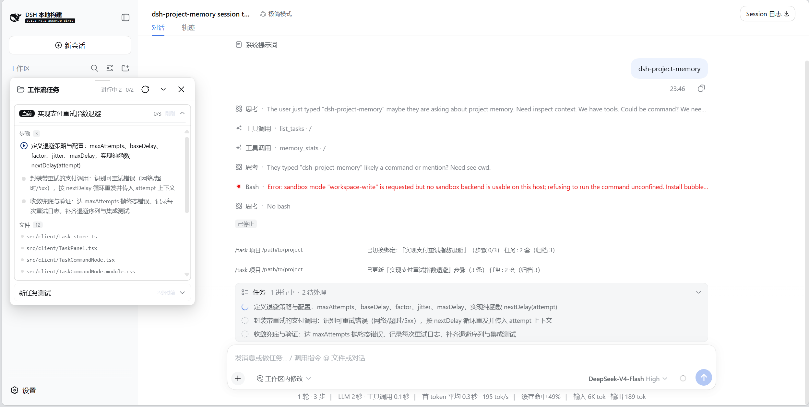

# dsh-project-memory

> If this plugin saves you an hour of debugging, a star would be appreciated.

[English](README.md) | [简体中文](README.zh-CN.md)

[](https://github.com/00080000/dsh-project-memory/actions/workflows/ci.yml) [](LICENSE) [](https://www.npmjs.com/package/@yolk_vat-y/dsh-project-memory) [](https://www.npmjs.com/package/@yolk_vat-y/dsh-project-memory) [](https://dsh-plugin.org/plugins/00080000/dsh-project-memory) [](https://awesome-dsh-plugin.com)


A persistent **project development memory** for [DeepSeek Harness](https://github.com/deepseek-ai/deepseek-harness) (dsh) agents. Built specifically for project development, natively integrated with dsh's task system: task lists and files read during a session are automatically persisted as cross-session task records, with tasks ↔ files linked — workflows can be switched and resumed, no need to re-scope the whole project, solving context loss. Underneath sits a **hybrid index**: document chunks, code symbols, experience notes and insights each form a layer, scored per layer and merged into one ranking. Documents (PDF/Markdown/txt) and code symbols are stored separately per workspace; documents are automatically cross-linked to the code symbols they mention. Experience notes (problem → solution) are automatically deduplicated, preventing repeated mistakes. Data survives session compaction and handover; recalls include `path:line` citations for source verification.

> The plugin keeps a compact project **memory** on disk, with every entry pointing to a concrete file and line — the agent can reorient quickly instead of re-reading the whole project.



## Features

- **TaskBridge: cross-session development tasks** — the session's todo list and the files it touches are persisted as per-project task entities, so a workflow can be switched and resumed without re-scoping the project. Associated files stay in recency-weighted order (a read never outranks a written file), so a resumed session sees where to look first. New sessions continue with `list_tasks` → `select_task`. Work delegated to subagents creates no task. On hosts without session events the task tools still work as a plain record list.
- **Task panel and editing** — draggable cards show a task's steps and files, and can collapse to a mini-bar or be hidden. Title, steps and status can be edited inline, writing back through the same path as model updates; four visual themes change material, geometry, typeface and density only, and colours follow the host. The panel stays hidden until summoned, syncs in the background on session switch, never reopens itself after a refresh, and a render failure cannot take down the host.
- **Document memory** — PDF, Markdown and plain text are chunked and summarized without a model call. Each entry keeps a short summary for injection, a bounded term set for recall, and a citation back to the source.
- **Code symbol memory** — a dependency-free scanner extracts functions, classes, methods, interfaces and type aliases with signatures; covered languages are JavaScript/TypeScript, Python, Go, Rust, C/C++/C#, Java and shell. Where `typescript` is installed, an optional second layer adds inferred return types, generics and interface shapes; it runs in the background and never blocks indexing.
- **Automatic, read-time memorization** — with lazy indexing (default), a file is memorized the moment the model reads it, so memory grows as a byproduct of normal work rather than an upfront scan. `index_repo` or a watched root can cover the rest of the tree; a background poll only re-indexes files that changed.
- **Doc ↔ code cross-linking** — a document that mentions a symbol is surfaced when that symbol is queried. Links are resolved against the current symbol table, so they cannot go stale.
- **Hybrid recall** — ranked search over documents, symbols, experience notes and insights, with optional LLM query expansion. The experience/insight layers are re-ordered by cosine when `leanvec` is present — installed by default, absent ⇒ pure lexical. Tuned for CJK: phrase boost, a synonym table, and CJK-aware boundaries for doc↔symbol linking.
  Russian (Cyrillic) is supported too: word splitting, a stopword list and Snowball stemming, so Russian queries hit Russian notes and take part in dedup.
- **Experience notes** — problems → solutions, deduplicated by overlap rather than repeated, bounded by project size, and surfaced both by search and by the same injection path as lessons.
- **Tiered insight memory (lessons / decisions / procedures)** — one entity across task, project and global scope. Near-duplicates merge or reinforce, and promotion moves an entry between scopes instead of copying it. Use is recorded, so decay and capacity rank by activity rather than age alone. The panel exposes a per-scope view for reviewing and editing entries. That list is ordered newest-first and loaded incrementally: 30 entries at a time, with the next page prefetched before the reader reaches the bottom and off-screen rows skipped by the renderer, so a large memory stays responsive.
- **Triggered injection** — an insight may carry an authored trigger: only `when` triggers, `guard` narrows it, and `prevents` records what breaks without the entry. Corpus text can never trigger an injection; the statistical channel is gated separately and silent by default. **Evidence is graded by source**: only host facts (structured tool calls, `fs`/`todo` events) and irreversible actions named by the human (commit / publish / release / push / deploy / go public) can inject full text; prose mentions of delete / clean up / render / benchmark only feed the hint channel, and subagent prompts plus notice-shaped messages never count as actions.
- **Usage is a skill too** — it registers `project-memory` into the host `skills` registry (a directory bundle with `scripts/pm-digest.mjs`, `resourceBase` pointing inside the package). The model loads the query/write workflow on demand instead of carrying it in every prompt; hosts without a `skills` service skip it silently.

## Installation

The plugin relies only on stable public APIs declared through peerDependencies.

```bash
cd dsh-project-memory && dsh plugin --profile web add . -w
```

The `-w` (workspace-root) flag is required: the profile directory is a pnpm workspace root, and pnpm rejects `add` there without it. From elsewhere, use the same command with an absolute path.

The plugin is also published on npm as a scoped package:

```bash
dsh plugin --profile web add @yolk_vat-y/dsh-project-memory -w
```

Each indexed project has its own store at `<root>/.dsh-project-memory/`. It keeps itself out of git by default — there is nothing to add to your `.gitignore`. Global-scope entries are kept outside the project in `~/.config/dsh-project-memory/global.json`; point `insight.globalFile` elsewhere to move it.

## Usage

The tools below are **invoked by the agent**, not typed by the user. In the chat, just ask naturally — e.g. "index this project" or "what does the auth module do?" — or simply keep working, and the agent calls the matching tool automatically. By default files are indexed the moment the model reads them, so memory fills in while you work. `watch_repo` keeps explicitly-watched roots fresh in the background; `index_repo` forces a full backfill (unchanged files are skipped).

| Tool | Purpose |
|---|---|
| `index_doc file_path` | Index one document (PDF/MD/txt): chunk, summarize deterministically, and store with a `path:line` citation. Unchanged files are skipped. |
| `index_repo root` | Index a whole project: documents get deterministic summaries, code files get a token-free symbol table. Incremental and self-healing: the store follows the file listing, so deleted, ignored or moved files are dropped (an entry created by an explicit `index_doc` is kept while its file still exists), and documents are cross-linked to symbols. A non-existent or excluded root is rejected before anything is written. |
| `watch_repo root` | Enable automatic refresh: a background poll detects new and changed files and re-indexes only those. A watched root is recorded in that project's store, so it resumes when dsh starts there; a non-existent or excluded root is refused, roots that disappear are dropped rather than re-created. |
| `pm_stats root` | Show what the store contains: totals, last index time, and the per-file list sorted by recency. Background index failures (watch or lazy, per root, most recent 50) are reported alongside, so a file that never made it into the corpus stays visible. |
| `query_memory query` | Ranked search over documents, symbols, experience and insights, optionally query-expanded by the LLM. `type` selects a layer (`all` / `doc` / `symbol` / `experience` / `insight` / `task`). Returns hits with relative scores, sources or insight ids, and doc→symbol references. |
| `list_tasks` | List task records for the project (archived marked). Call first in a new session before continuing work. |
| `select_task` | Bind the session to a task so its todo list and file reads sync into it. Exact `taskId`, or exact `title` (multiple matches return candidates; no match creates a new task). Pass `title` with `taskId` to rename. Auto-unarchives. |
| `archive_task` | Archive a task (hide from default views, exclude from capacity, stop syncing, unbind the sessions that had it selected; archived tasks are also skipped by injection and recall). `select_task` restores it. |
| `show_task_panel` | Show the task panel in the UI. Call when the user asks to see the task list or when you want to display the panel. |
| `/tasks` (typed by the user, not the model) | The only user command: shows the task stack and drives the workflow card. Every other action is a **sub-verb** invoked by card buttons: `switch` / `archive` / `unbind` / `rename` / `todos …` / `step` / `step-move` / `step-text` for tasks, `insight list [scope] [offset] [limit]` / `confirm` / `promote` / `demote` / `archive` / `restore` / `delete` / `save` / `edit` for memory. |
| `remember problem solution` | Save an experience note. It is a `kind: 'experience'` insight — same store, same dedup and same delete path as lessons / decisions / procedures. Similar problems merge or overwrite instead of duplicating. |
| `forget id_or_query` | Delete memories — lessons / decisions / procedures and experience notes alike, across task / project / global in one call, without knowing which layer the entry lives in. An exact id deletes that one entry; keywords match by **query-side coverage** (matched query terms ÷ query terms). Real deletion, no undo; when keywords match more than the cap (default 10) it deletes nothing and only lists the candidates. The **5** most recently deleted entries are kept as full entries in that layer's `deleted.json` next to its store (`<root>/.dsh-project-memory/deleted.json` for the project layer, beside the global file for global), and the deletion result prints that path — read it and save again to recover a mis-delete. |
| `save_lesson` | Save a lesson / decision / procedure at task, project or global scope; passing `id` **overwrites that entry in place** (only the fields you pass, the previous values stay in `prev` — write them back with the same id). Before writing it compares against existing memory: cosine ≥ 0.9 auto-overwrites that entry, ≥ 0.7 reports the nearest id in the result; without `leanvec` it falls back to lexical overlap ≥ 0.7 merge / 0.65–0.7 reinforce. Two tasks hitting the same insight promote it task → project, three or more → global. Key params: `id`, `title`, `kind`, `scope`, the content (`pattern`/`fix`, `choice`/`reason` or `steps`), and `trigger` (`when` is the only trigger surface, `guard` narrows it, `prevents` records what breaks without it). |

`/tasks` appears in the web `/` menu inside an icon-bearing **Workflow** group, with three view entries — Tasks / Project Memory / Global Memory (labelled in the UI language). It is the plugin's only registered command; every other action rides it as a sub-verb driven by card buttons.

## How it works

The design follows four principles:

- **Volatility** — context is ephemeral; it is lost when a session is compacted.
- **Persistence** — the **memory** is stored on disk and survives compaction and new sessions.
- **Compactness** — one bounded declaration line per symbol, and a ≤300-char summary plus a bounded term set per document chunk. Doc→symbol links are not stored; they are computed at read time.
- **Verifiability** — **recalls** carry a `path:line` citation where applicable, so the agent can confirm details against the source.

With default lazy indexing, building the **memory** does not require an upfront scan: files are memorized as the model reads them, so the **memory** grows to cover what has been worked with; `index_repo` or a watched root can cover the rest. Re-reading an unchanged file is a no-op, so the **memory** stays fresh with minimal ongoing overhead.

Project- and task-scope memory is stored per project and follows the codebase: changed files are re-extracted by content hash, deleted files are removed. Experience notes are ordinary `kind: 'experience'` entries in `insights.json`: recallable, deduplicated, and eligible for the same gated hint channel as lessons.

## Design

```
.dsh-project-memory/
  format.json      layout marker
  shards/          bucket-*.json, ≈32KB each — a write rewrites only the affected bucket(s)
  watch.json       watched roots
  tasks.json       TaskBridge task entities (cross-session)
  binding.json     current session ↔ task binding
  insights.json    project-scope memory (lessons / decisions / procedures / experience notes) — one entity
  vectors.json     optional semantic index (only when the vector layer runs)
```

Global-scope entries are not stored under the project: they live in `insight.globalFile` (default `~/.config/dsh-project-memory/global.json`) so every project sees them.

- **Incremental** — a content hash per file; only changed files are re-extracted.
- **Cross-linking** — a returned document chunk resolves the symbols it mentions against the **current** symbol table and appends them as `references`, so a doc indexed before its symbols still links correctly.
- **Query expansion** — when enabled, `query_memory` asks the LLM to rewrite the query into several variants (synonyms, EN/CN, identifier guesses) and merges the scores; when off, queries never touch the LLM. Indexing itself is model-free.


## Configuration

| Key | Default | Meaning |
|---|---|---|
| `memoryDir` | `.dsh-project-memory` | store directory inside each indexed root. Must stay a relative path inside the root: `.`, `..`, any `..` segment or an absolute path falls back to the default with one warning (otherwise the store lands outside the root, or on the root itself and self-ignores the whole repository) |
| `chunkChars` / `maxChunksPerFile` | 3000 / 40 | max chars per document chunk, max chunks per document |
| `maxFileSizeMb` | 10 | skip documents (incl. PDF) and code files larger than this (MB); entries of an already-indexed file that later grows past the cap are dropped on the next scan / watch pass |
| `maxPdfPages` | 1000 | PDF page cap |
| `lazyIndexing` | true | index files the moment the model reads them |
| `autoIndexOnFirstUse` | false | full scan of the current working directory on plugin load (opt-in) |
| `watch` / `watchInterval` | true / 30 | background refresh; base poll interval in seconds (polls stay quiet while a turn is running — a 5-minute fallback keeps external edits fresh — and one merged scan runs at turn end; idle polls back off up to 2 minutes and reset on any change) |
| `maxScanFiles` / `maxScanDepth` | 20000 / 12 | per-scan caps on files and directory depth; a truncated pass is reported and never removes what it did not reach. Cannot be disabled: `0` or any invalid value falls back to the default |
| `roots.allow` / `roots.deny` / `roots.exclude` | `[]` / `[]` / `[]` | custom root lists (machine/profile level, CLI and web alike). `allow` / `deny` match the directory itself exactly; `exclude` is a path-boundary prefix and covers the whole subtree (no file under it enters the index). Priority: `exclude` > `deny` > `allow` > built-in list; the filesystem root can never be a root. `~` / `~/...` expansion, non-absolute entries are ignored with a one-time stderr warning, Windows is case-insensitive |
| `llmQueryExpansion` / `expansionCount` | false / 6 | expand queries via the LLM before search (off by default to save tokens); max variants |
| `tsPath` / `enableTypeScript` | (auto) / true | optional absolute path to a specific `typescript` install; set `enableTypeScript: false` to disable the type-aware layer entirely |
| `tasklist.enabled` / `tasklist.syncHostOnAdopt` | true / true | TaskBridge auto-sync (task entities from the session todo list and file reads); push a bound task's steps to the host task list so dsh mirrors it |
| `insight.*` | dedupOverlap `0.7` · reinforceBand `0.65` · autoMergeCos `0.9` · autoMergeMargin `0.05` · hintCos `0.7` · maxForgetMatches `10` · maxProject `100` · maxGlobalProcedures `200` · promoteConfidence `0.7` · globalPromoteTasks `3` · decayDays `90` · `globalFile` (auto) | insight dedupe / auto-overwrite / near-neighbour hint / delete cap / reinforce / promotion / capacity / archive settings. `autoMergeCos` / `hintCos` = `0` turns that band **off** |
| `autoContext.enabled` | true | silent injection wrapper (resident task card + gated items); inert until the host exposes a resolvable session cwd. `maxTokens` `400` (per step; `0` turns injection off entirely), `editedMax` `3` (recently written files shown on the task card), `signalMinRatio` `0.5` (a hint must reach half of its layer's top score), `skipEchoSelfTodo` `true`, `rootNotice` `true` |
| `autoContext.vectorDir` | unset | **optional** semantic layer over the experience/insight layers, on by default via the `leanvec` optionalDependency (≈85 MB table, ≈+45 MB RSS). `off` forces pure lexical; a path or `DSH_LEANVEC_DIR` overrides it. Re-orders only, returned counts unchanged; while it is active only entries that got **no** cosine are still filtered by lexical match count |
| `autoContext.vectorAlpha` | 0.5 | weight of `(1-α)·lexical + α·cosine` in those layers; `0` disables re-ranking only (write-side dedup stays on), `1` (pure vector) measured worse |

### Toggling features

The two most relevant switches are `lazyIndexing` (index a file the moment the model reads it; default on) and `autoIndexOnFirstUse` (full scan of the current working directory on plugin load; default off). Lazily indexed project roots are automatically registered with the watcher, so changed files stay fresh without an explicit `watch_repo`.

**Root resolution.** In order: an explicit `root` argument; a registered root (`watch_repo`); the nearest ancestor with a VCS marker (`.git`/`.hg`/`.svn`) or a build/manifest marker (`package.json`, `go.mod`, `Cargo.toml`, `pyproject.toml`, …); the session working directory, unless it is on the excluded list. A file that matches none of these is not indexed.

When the root comes from the working directory, the model gets one notice per session naming it and how to change it; mute with `autoContext.rootNotice: false`. Starting dsh in a container directory such as `~/workspace` therefore makes that directory the root, and memory spans everything beneath it up to the scan limit — start dsh inside the project for one store per project.

The store lives in the tree it indexes and **ignores itself**: a `*` rule inside the store keeps it out of `git status` and `git add -A`, and means `git clean -fd` leaves it alone. To commit project memory deliberately, `git add -f .dsh-project-memory` — tracked files are not affected by ignore rules.

Settings live in the plugin's config object. To change them, add an override entry to your profile's `cordis.patch.yml` — for the web profile that is `~/.dsh/profiles/web/cordis.patch.yml`:

```yaml
- id: project-memory
  config:
    lazyIndexing: true          # on: index files as the model reads them (default)
    autoIndexOnFirstUse: false  # off: no upfront full scan (default)
    llmQueryExpansion: false    # off: do not spend tokens on LLM query expansion (default)
    watch: true                 # on: background refresh for watched roots (default)
    watchInterval: 30           # base poll interval; quiet during a turn, one merged scan at turn end, idle backoff to 2 min
    maxScanFiles: 20000         # per-scan file cap (truncation is reported, never deletes)
    maxScanDepth: 12            # per-scan directory-depth cap
    enableTypeScript: true      # on: type-aware enhancement when TS is installed (default)
    # allowUnsafeRoots: false   # release the built-in list; prefer roots.allow below
    # roots:                     # custom root lists (empty by default)
    #   allow: [/srv/projects/demo]        # exact release of a built-in directory (filesystem root excluded)
    #   deny: [/srv/shared]                # exact: this directory cannot be a root; children still can
    #   exclude: [/srv/monorepo/archive]   # subtree prefix: no file under it enters the index
    # tsPath: /custom/path/to/typescript  # optional: force specific TS install
```

Only list the keys you want to change; the rest fall back to the plugin defaults. Verify the result with `dsh --profile web --dump-config`.

**On the web profile, three of these keys also have a visual card.** It sits at **Plugins → Project memory → detail page → Common settings** (`plugins.bundle.config`, keyed by package name): `autoIndexOnFirstUse`, `watchInterval` (seconds) and `llmQueryExpansion`. Saving goes through the host's `settings` interface — the card is a projection of the same config the profile override above feeds, not a separate file. `watchInterval` and `llmQueryExpansion` take effect immediately (the poll timer is re-armed, the expansion flag is read per query); `autoIndexOnFirstUse` is a one-off startup action, so the card says "effective next start". These three are resolved when the plugin is assembled, so **restart dsh once after upgrading** (saving the card itself needs no restart).

For a one-off run without editing the profile, pass the override as a CLI patch overlay:

```bash
dsh web --patch ./config.yml
```

where `config.yml` contains the same override block.

## Performance

Synthetic code corpus (≈4–5 symbols per file), Node 24 on Linux, second warm run:

| Corpus | Full index | Cold load | Cached query p50 / p95 | Re-index 1 file |
|---|---:|---:|---:|---:|
| 5,000 files / 20k entries | 218 ms | 49 ms | 4.9 / 9.7 ms | 1.6 ms |
| 10,000 files / 40k entries | 417 ms | 103 ms | 11.4 / 21.9 ms | 3.0 ms |

Cold load is a fresh read of the store; the first query after a write rebuilds the IDF cache (79 ms at 20k entries, 153 ms at 40k), later queries hit it. Re-indexing a changed file is O(file), not O(corpus).

### Reproduce it on your own project

The measurement ships with the repository **and with the published npm package** (`scripts/` is part of the tarball). It needs **no dsh instance, no network and no model calls**, and never touches your project's own store — results go to a temp directory and are removed afterwards:

```bash
npm run bench -- /path/to/your/project
# or, with options:
node scripts/bench.mjs /path/to/your/project [--json] [--samples 100] [--no-pdf] [--keep]
```

It reports the cold index split into read+hash / extract / commit, cold load, IDF rebuild, cold and hot query latency (p50/p95/max over 100 sampled queries through the shipped scorer), single-file hot re-index, store size, resident heap and bytes per entry. Pass `--queries your-queries.json` to run the labeled-set method (hit@5 / hit@10 / MRR) against your own project.

## Development (for contributors)

These commands are for **maintaining the plugin code** — regular users do not need them. Installing the plugin only requires the command in [Installation](#installation).

```bash
npm install
npm test                    # 1088 tests
npm run eval:injection      # synthetic pool P/R: precision 0.93 / recall 1.00, + a 3-scenario hint-only group
npm run eval:injection -- --store .dsh-project-memory/insights.json   # replay on YOUR store; control group is a hard gate
npm run selfcheck:triggers  # which entries can still push, which declarations are dead (reads your local store)
npm run bench -- /path/to/project   # index/query performance on any project — no dsh needed
npm run bench:peak          # peak-RSS budget of maxFileSizeMb, measured on a 1–50 MB ladder
npm run schema:size         # per-tool fixed prompt cost: chars and a same-scale token estimate
```

Release notes live in [`CHANGELOG.md`](CHANGELOG.md) and on [GitHub Releases](https://github.com/00080000/dsh-project-memory/releases).

## License

MIT — see [`LICENSE`](LICENSE).

Copyright (c) 2026 00080000 &lt;3388065969@qq.com&gt;
