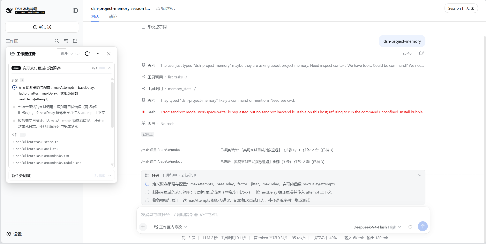

# dsh-project-memory

> 如果这个插件帮你省下 1 小时 Debug 时间，请点个 Star。

[English](README.md) | [简体中文](README.zh-CN.md)

[](https://github.com/00080000/dsh-project-memory/actions/workflows/ci.yml) [](LICENSE) [](https://www.npmjs.com/package/@yolk_vat-y/dsh-project-memory) [](https://www.npmjs.com/package/@yolk_vat-y/dsh-project-memory) [](https://dsh-plugin.org/plugins/00080000/dsh-project-memory) [](https://awesome-dsh-plugin.com)

为 [DeepSeek Harness](https://github.com/deepseek-ai/deepseek-harness)（dsh）agent 提供持久化的 **项目开发记忆**。专门针对项目开发，原生融合 dsh 任务系统，会话内任务清单与读过的文件自动沉淀为跨会话任务记录，任务↔文件自动关联——开发工作流可切换、可续接，无需重复梳理整个项目，解决上下文失效。底层是一套**混合索引**：文档块、代码符号、经验笔记与洞察各占一层，召回时分层打分再合并排序。文档（PDF/Markdown/txt）与代码符号写入工作区独立存储，文档自动交叉链接至所提及的代码符号；经验笔记（问题 → 方案）自动去重，避免重复踩坑。数据跨会话压缩与交接保留，召回附带 `路径:行号` 可回源核实。


> 插件在磁盘上维护一份精简的项目**记忆**，每条记录指向具体的文件与行号；agent 需要快速了解项目时先查**记忆**，无需重读整个项目。


## 特性

- **TaskBridge：跨会话开发任务** — 会话内的任务清单与触碰过的文件持久化为项目任务实体，工作流可以随时切走再续接，不必重新界定项目范围。关联文件按最近活跃排序（读取永远不越过写过的文件），续接时一眼看到该先看哪些。新会话通过 `list_tasks` → `select_task` 续接。委派给子代理的工作不会建档。宿主不提供会话事件时，任务工具仍可作为普通记录列表使用。
- **任务面板与编辑** — 卡片可拖拽，展示任务步骤与涉及文件，可折叠为迷你条或彻底隐藏；标题、步骤与状态支持行内编辑，与模型更新走同一条写回路径；四档外观风格只改材质、几何、字型与密度，颜色跟随宿主。面板默认隐藏，仅在显式唤起后出现；会话切换只后台同步，刷新页面不会自行打开；渲染错误有边界兜底，面板崩溃不会拖垮宿主。
- **文档记忆** — PDF、Markdown 与纯文本按块切分并生成摘要，索引期不调用模型。每条保留一段简短摘要供注入、一个有界的检索词集合，以及回源引用。
- **代码符号记忆** — 零依赖扫描器提取函数、类、方法、接口与类型别名及其签名，覆盖 JavaScript/TypeScript、Python、Go、Rust、C/C++/C#、Java 与 shell。项目装了 `typescript` 时，可选第二层补推导返回类型、泛型与接口，后台执行、不阻塞索引。
- **读到即记忆、变更即刷新** — 默认开启懒索引：文件在模型实际读取的瞬间被记忆，记忆是正常工作的副产品，而不是额外的一次全量扫描。`index_repo` 或监听根目录可以覆盖其余文件；后台轮询只重记变更过的文件。
- **文档 ↔ 代码交叉链接** — 文档提及的符号，在查询该符号时一并带出。链接按**当前**符号表解算，不会过期。
- **混合召回** — 对文档、符号、经验笔记与 insight 排序召回，可选 LLM 查询扩展。`leanvec` 是 optionalDependency：默认装上并按余弦重排经验/洞察两层，没装或 `vectorDir: 'off'` 则退回纯词法。针对 CJK 增强：短语加分、同义词表，以及文档↔符号链接的词边界处理。俄语（西里尔）同样支持：切词 + 虚词表 + Snowball 词干，俄文查询能命中俄文条目，也参与去重。
- **经验笔记** — 记录问题 → 方案；相似问题覆盖而不重复，数量随项目规模有界，与教训走同一条注入通道：检索与自动注入都能带出。
- **分层 insight 记忆（教训 / 决策 / 流程）** — 同一实体贯穿任务、项目、全局三级。近重复合并或强化；提升是更换归属而非复制。被使用会记账，因此衰减与容量按活跃度排序，而不是只按时间。面板提供分级的记忆视图用于审核与编辑；列表按新→旧排列并增量加载——每页 30 条，滚到底前就预取下一页，离屏行不参与渲染，记忆变多也不卡。
- **触发式注入** — insight 可携带 authored trigger：只有 `when` 能触发，`guard` 只能收窄，`prevents` 记下没有它会坏在哪。语料正文永远不能触发注入；统计通道另有独立门槛，默认沉默。**证据来源分级**：只有宿主事实（结构化工具调用、`fs`/`todo` 事件）与真人消息里的不可逆外部动作（提交 / 发布 / 发版 / 推送 / 部署 / 公开）能触发全文注入；散文里的"删除 / 清理 / 渲染 / 基准"只进提示通道，子代理提示词与通知类消息不参与动作判定。
- **用法也是一个 skill** — 向宿主 `skills` 注册 `project-memory`（目录 bundle，含 `scripts/pm-digest.mjs`，`resourceBase` 指向包内目录）。模型按需加载查询 / 写入流程，不占常驻提示；没有 `skills` 服务的宿主静默跳过。

## 安装

插件只依赖通过 peerDependencies 声明的稳定公共 API。

```bash
cd dsh-project-memory && dsh plugin --profile web add . -w
```

`-w`（workspace-root）标志是必需的：profile 目录是 pnpm 工作区根目录，不带该标志 pnpm 会拒绝 add。其他目录下用同样的命令加上绝对路径即可。

插件同时发布在 npm 上（scoped 包）：

```bash
dsh plugin --profile web add @yolk_vat-y/dsh-project-memory -w
```

每个被索引的项目在 `<root>/.dsh-project-memory/` 下有独立存储；它默认就把自己排除在 git 之外，`.gitignore` 无需任何添加。global 级条目单独存放于 `~/.config/dsh-project-memory/global.json`；可用 `insight.globalFile` 改到别处。

## 用法

以下工具由 **agent 自动调用**，无需用户手动输入。在对话中直接说自然语言即可——例如「给这个项目建个索引」或「auth 模块是干嘛的」，或者正常开发即可——agent 会自动调用对应工具。默认开启「读到即索引」：模型读哪个文件，就顺便索引哪个文件，记忆在你干活的过程中自然积累。`watch_repo` 让显式监听的根目录在后台保持新鲜；`index_repo` 强制对项目做一次全量回填（未变更文件自动跳过）。

| 工具 | 用途 |
|---|---|
| `index_doc file_path` | 索引单个文档（PDF/MD/txt）：分块、确定性摘要，带 `路径:行号` 入库。未变更文件自动跳过。 |
| `index_repo root` | 索引整个项目：文档生成确定性摘要，代码文件生成零 token 符号表。增量更新，store 跟随文件清单：已删除、被忽略或移走的文件会被清理（显式 `index_doc` 的条目只要文件还在就保留）；文档与符号交叉链接。根目录不存在或在排除名单上时，会在写入任何内容前拒绝。 |
| `watch_repo root` | 启用自动刷新：后台轮询检测新增/变更文件，仅重抽这些文件。监听根会记在该项目的 store 里，在该项目下启动 dsh 时恢复监听；不存在或在排除名单上的根目录会被拒绝，已消失的根目录会被丢弃而不是被重新创建。 |
| `memory_stats root` | 查看记忆库内容：总量、最近索引时间，以及按时间排序的逐文件清单。后台索引失败（watch / 懒索引，按根记账、最多 50 条）也会一并报出，让「文件一直没进语料」可见。 |
| `query_memory query` | 对文档、符号、经验与 insight 执行排序检索，可选 LLM 查询扩展。`type` 选择层（`all` / `doc` / `symbol` / `experience` / `insight` / `task`）。返回带相对分数、引用或 insight id、以及文档→符号链接的结果。 |
| `list_tasks` | 列出本项目任务记录（含归档，带标记）。新会话/续接前先调用。 |
| `select_task` | 将会话绑定到某任务（此后 todo 清单与读文件同步进该任务）。按 `taskId` 精确绑定，或按 `title` 完全匹配（多个同名返回候选；无则新建）。带 title 可改名；自动解归档。 |
| `archive_task` | 归档任务（隐藏默认视图、不占容量、停止同步、清掉选中它的会话绑定；归档任务也不再参与注入与召回）。`select_task` 可恢复。 |
| `show_task_panel` | 在 UI 中打开任务面板。用户要求查看任务列表或你想展示面板时调用。 |
| `/tasks`（用户输入，不经模型） | 唯一的用户命令：展示任务栈并驱动工作流卡片。其余动作是它的**子动词**，由卡片按钮调用：`switch` / `archive` / `unbind` / `rename` / `todos …` / `step` / `step-move` / `step-text` 为任务动作，`insight list [scope] [offset] [limit]` / `confirm` / `promote` / `demote` / `archive` / `restore` / `delete` / `save` / `edit` 为记忆动作。 |
| `remember problem solution` | 保存经验笔记。它就是 `kind: 'experience'` 的 insight——与教训 / 决策 / 流程同库、同去重、同删除入口。相似问题合并或覆盖而非重复。 |
| `forget id_or_query` | 删除记忆——教训 / 决策 / 流程与经验笔记一视同仁，task / project / global 全层一次搞定，不必先知道它在哪一层。精确 id 删那一条；关键词按**查询侧覆盖率**匹配（命中词 ÷ 查询词数）。真删、无撤销；关键词命中超过上限（默认 10）时**一条都不删**，只列出候选。最近删除的 **5 条**会以完整条目留在该层 store 同目录的 `deleted.json`（项目层 `<root>/.dsh-project-memory/deleted.json`，global 层在 global 文件旁），删除回报里给出真实路径——删错时读它、重新保存一次即可找回。 |
| `save_lesson` | 在 task/project/global 任一作用域保存教训 / 决策 / 流程；带 `id` 就是**就地覆盖**既有条目（只改本次显式传的字段，旧值留在 `prev`，用同一个 id 再写一次即可写回）。写入前与既有记忆比对：余弦 ≥ 0.9 自动覆盖那一条，≥ 0.7 在返回里提示近邻 id；`leanvec` 不在时退回词法 overlap ≥ 0.7 合并、0.65–0.7 强化。同一 insight 被 2+ 任务命中自动 task→project、3+ → global。主要参数：`id`、`title`、`kind`、`scope`、正文（`pattern`/`fix`、`choice`/`reason` 或 `steps`）、`trigger`（`when` 是唯一触发面，`guard` 只能收窄，`prevents` 记下没有它会坏在哪）。 |

`/tasks` 在 web 的 `/` 菜单里以带图标的**「工作流」**组呈现 —— 三个视图入口：任务 / 项目记忆 / 全局记忆（标题随界面语言切换）。它是插件唯一注册的命令，其余动作全部作为它的子动词由卡片按钮驱动。

## 工作原理

设计遵循四个原则：

- **易失性** — 上下文是临时的，会话压缩即丢失。
- **持久性** — **记忆**存于磁盘，跨压缩与会话保留。
- **紧凑性** — 代码层每个符号只存一行有界声明，文档层每个 chunk 保留 ≤300 字符的摘要与有界词项。doc→symbol 链接不落盘，读取期计算。
- **可核验性** — **召回**在适用时携带 `路径:行号` 引用，agent 可对照源文件核实。

默认开启懒索引时，构建**记忆**无需预先全量扫描：文件在模型读取时被记忆，**记忆**恰好覆盖实际处理过的内容；`index_repo` 或监听根可以覆盖其余文件。未变更的文件重读是空操作，因此持续维护开销很低。

项目级与任务级记忆按项目保存，并跟随代码库变化：文件变更按内容哈希重新抽取，文件删除则同步移除。经验笔记是 `insights.json` 里普通的 `kind: 'experience'` 条目：可检索、参与去重，也能进入与教训相同的受门槛约束的提示通道。

## 设计

```
.dsh-project-memory/
  format.json      布局标记
  shards/          bucket-*.json，每桶约 32KB —— 写入只重写受影响的那一个桶
  watch.json       被监听根目录
  tasks.json       TaskBridge 任务实体（跨会话）
  binding.json     当前会话 ↔ 任务绑定
  insights.json    项目级记忆（教训 / 决策 / 流程 / 经验笔记）——唯一实体
  vectors.json     可选语义索引（只在向量层启用时存在）
```

global 级条目不放在项目里：它们在 `insight.globalFile`（默认 `~/.config/dsh-project-memory/global.json`），所有项目共享。

- **增量** — 按文件内容哈希，仅重新抽取变更文件。
- **交叉链接** — `query_memory` 返回文档 chunk 时，按**当前**符号表解算它提到的符号，以 `references` 带出。文档先索引、符号后到也能链上。
- **查询扩展** — `llmQueryExpansion` 开启时，把查询改写为多个变体（同义词、中英、符号名猜测）再合并分数；关闭时查询完全不碰 LLM。索引本身不调用模型。


## 配置

| 键 | 默认值 | 含义 |
|---|---|---|
| `memoryDir` | `.dsh-project-memory` | 每个被索引根目录内的存储目录。必须是根内的相对路径：`.`、`..`、含 `..` 段或绝对路径都会回落到默认目录并告警一次（否则 store 会落到根外，或落到根上并把整个仓库自我忽略掉） |
| `chunkChars` / `maxChunksPerFile` | 3000 / 40 | 每个文档块最大字符数、每文档最大块数 |
| `maxFileSizeMb` | 10 | 大于该值（MB）的文档（含 PDF）/代码文件跳过；已经索引过的文件后来涨过阈值，旧条目会在下一轮扫描 / watch 时摘掉 |
| `maxPdfPages` | 1000 | PDF 页数上限 |
| `lazyIndexing` | true | 模型读取文件的瞬间即索引 |
| `autoIndexOnFirstUse` | false | 插件加载时对当前工作目录做全量扫描（可选） |
| `watch` / `watchInterval` | true / 30 | 后台刷新；基础轮询间隔（秒）；回合进行中静默（5 分钟兜底，外部改动仍会自愈），回合结束立刻合并扫一次；空闲时逐步退避到最长 2 分钟，一有变化立即回到该值 |
| `maxScanFiles` / `maxScanDepth` | 20000 / 12 | 单次扫描的文件数与目录深度硬上限；被截断时会在报告里说明，且不会删除没扫到的条目。**无法取消**：`0` 或任何非法值都回落到默认值 |
| `roots.allow` / `roots.deny` / `roots.exclude` | `[]` / `[]` / `[]` | 自定义根名单（机器/配置档级，CLI 与 web 通用）。`allow` / `deny` 精确匹配目录本身；`exclude` 按路径边界前缀匹配整棵子树（其中的文件一律不进索引）。优先级 `exclude` > `deny` > `allow` > 内置名单，文件系统根永远不能当根。支持 `~`/`~/...`；非绝对路径忽略并在 stderr 告警一次；Windows 下大小写不敏感 |
| `llmQueryExpansion` / `expansionCount` | false / 6 | 检索前用 LLM 扩展查询（默认关闭，节省 token）；扩展变体上限 |
| `tsPath` / `enableTypeScript` | (自动) / true | 可选：强制指定 `typescript` 安装路径；`enableTypeScript: false` 彻底禁用类型感知层 |
| `tasklist.enabled` / `tasklist.syncHostOnAdopt` | true / true | TaskBridge 自动同步（由会话 todo 清单与文件读取沉淀任务实体）；绑定任务时把其步骤推给宿主任务清单，使 dsh 镜像该任务 |
| `insight.*` | dedupOverlap `0.7` · reinforceBand `0.65` · autoMergeCos `0.9` · autoMergeMargin `0.05` · hintCos `0.7` · maxForgetMatches `10` · maxProject `100` · maxGlobalProcedures `200` · promoteConfidence `0.7` · globalPromoteTasks `3` · decayDays `90` · `globalFile`（自动） | insight 去重 / 自动覆盖 / 近邻提示 / 删除上限 / 强化 / 提升 / 容量 / 归档设置。`autoMergeCos` / `hintCos` 设 `0` 表示**关闭**那条带 |
| `autoContext.enabled` | true | 静默注入包装（常驻任务卡 + 受门槛约束的条目）；宿主无法解析会话 cwd 时完全透传。`maxTokens` `400`（单轮；`0` = 完全关闭注入）、`editedMax` `3`（任务卡显示的最近"编辑中"文件数）、`signalMinRatio` `0.5`（提示至少达到该层最高分的一半）、`skipEchoSelfTodo` `true`、`rootNotice` `true` |
| `autoContext.vectorDir` | 未设 | **可选**语义层，只作用于经验/洞察两层；随 `leanvec`（optionalDependency）默认装上并启用（约 85 MB 表、约 +45 MB RSS）。填 `off` 强制纯词法；填路径或用 `DSH_LEANVEC_DIR` 可覆盖。只改排序、返回条数不变；启用时只有**没拿到余弦**的条目才继续按词法命中数筛 |
| `autoContext.vectorAlpha` | 0.5 | 这两层内 `(1-α)·词法分 + α·余弦` 的权重；`0` 只关闭重排（写入侧去重仍在），`1`（纯向量）实测更差 |

### 功能开关

两个最常用的开关是 `lazyIndexing`（模型读取文件的瞬间即索引；默认开启）和 `autoIndexOnFirstUse`（插件加载时对当前工作目录做全量扫描；默认关闭）。懒加载建立的索引根会自动注册到 watcher，文件变更无需手动 `watch_repo` 也能保持新鲜。

**项目根怎么定。** 按顺序：显式 `root` 参数 → 登记的根（`watch_repo`）→ 最近的 VCS 标记（`.git`/`.hg`/`.svn`）或构建/清单标记（`package.json`、`go.mod`、`Cargo.toml`、`pyproject.toml` 等）所在祖先 → 会话工作目录（前提是它不在排除名单里）。都不命中则不索引该文件。

根来自工作目录时，模型每个会话收到一条通告，说明根的位置与改法；`autoContext.rootNotice: false` 关闭。因此在 `~/workspace` 这类容器目录里启动 dsh，该目录就是根，记忆覆盖其下所有项目直到扫描上限——想一个项目一个 store，就在项目目录里启动。

store 建在被索引的目录树里，并且**自我忽略**：自己目录内的一条 `*` 规则让它不出现在 `git status` / `git add -A` 里，`git clean -fd` 也不会删它。确实想把记忆跟着仓库提交：`git add -f .dsh-project-memory`——已跟踪文件不受忽略规则影响。

配置存放在插件的 config 对象中。修改方式：在 profile 的 `cordis.patch.yml` 里加一条覆盖项——web profile 对应 `~/.dsh/profiles/web/cordis.patch.yml`：

```yaml
- id: project-memory
  config:
    lazyIndexing: true          # 开启：模型读到哪个文件就索引哪个（默认）
    autoIndexOnFirstUse: false  # 关闭：不做加载时的全量扫描（默认）
    llmQueryExpansion: false    # 关闭：不用 LLM 扩展查询，节省 token（默认）
    watch: true                 # 开启：被监听根目录后台保持新鲜（默认）
    watchInterval: 30           # 基础轮询间隔；回合进行中静默、回合结束补扫，空闲退避到最长 2 分钟
    maxScanFiles: 20000         # 单次扫描文件上限（截断会报告，且不会误删旧条目）
    maxScanDepth: 12            # 单次扫描目录深度上限
    enableTypeScript: true      # 开启：装了 TS 时启用类型感知增强（默认）
    # allowUnsafeRoots: false   # 放开内置名单；优先改用下面的 roots.allow
    # roots:                     # 自定义根名单（默认全空）
    #   allow: [/srv/projects/demo]        # 精确放行内置名单里的目录（文件系统根不可放行）
    #   deny: [/srv/shared]                # 精确拒绝这个目录本身；子目录仍可成根
    #   exclude: [/srv/monorepo/archive]   # 子树前缀：里面的文件一律不进索引
    # tsPath: /custom/path/to/typescript  # 可选：强制指定 TS 安装路径
```

只需列出要改的键，其余键回落到插件默认值。用 `dsh --profile web --dump-config` 验证生效。

**web profile 上有三个键同时提供可视化设置。** 位置是**插件 → 项目记忆 → 详情页 → 常用设置**（`plugins.bundle.config`，key 为包名）：`autoIndexOnFirstUse`、`watchInterval`（秒）、`llmQueryExpansion`。保存走宿主的 `settings` 接口——卡片始终是上面那份 profile 配置的投影，不另写文件。`watchInterval` 与 `llmQueryExpansion` 立即生效（轮询定时器当场重排，扩展开关每次查询时读取）；`autoIndexOnFirstUse` 是一次性启动动作，卡片上写明"下次启动生效"。这三个键在插件装配期解析，所以**升级后需要重启一次 dsh**（在卡片里保存则无需重启）。

不想改 profile 文件、只想临时试一次，可用 CLI 补丁覆盖：

```bash
dsh web --patch ./config.yml
```

其中 `config.yml` 内容就是上面的覆盖块。

## 性能

合成代码语料（每文件约 4–5 个符号），Node 24 / Linux，第二遍热缓存：

| 语料 | 全量索引 | 冷加载 | 缓存查询 p50 / p95 | 单文件重索引 |
|---|---:|---:|---:|---:|
| 5,000 文件 / 20k 条目 | 218 ms | 49 ms | 4.9 / 9.7 ms | 1.6 ms |
| 10,000 文件 / 40k 条目 | 417 ms | 103 ms | 11.4 / 21.9 ms | 3.0 ms |

冷加载是首次读盘；写入后的首次查询会重建 IDF 缓存（20k 条目 79 ms，40k 条目 153 ms），之后命中缓存。重索引一个变更文件是 O(文件)，不是 O(语料)。

### 自己复现这些数字

测量本身随仓库发布，**也随 npm 包一起发布**（`scripts/` 已包含在 tarball 中）。脚本**不需要 dsh 实例、不需要网络、不调用任何模型**，也**不碰被测项目自己的 store**——结果写进临时目录，跑完删除：

```bash
npm run bench -- /你的/项目路径
# 或带参数：
node scripts/bench.mjs /你的/项目路径 [--json] [--samples 100] [--no-pdf] [--keep]
```

输出包含：冷索引（拆成 read+hash / extract / commit 三段）、冷加载、IDF 重建、冷查询与热查询延迟（100 条采样报 p50/p95/max）、单文件热重索引、存储体积、常驻堆与单条目字节数。带 `--queries 你的查询集.json` 可以在你自己的项目上跑标注集方法（hit@5 / hit@10 / MRR）。

## 开发（面向贡献者）

以下命令用于**维护插件源码**，普通用户无需执行。安装插件只需使用[安装](#安装)一节中的命令。

```bash
npm install
npm test                    # 1088 项测试
npm run eval:injection      # 合成池 P/R：精确率 0.93 / 召回率 1.00，另有 3 个 hint-only 场景
npm run eval:injection -- --store .dsh-project-memory/insights.json   # 用你自己的 store 重放；对照组是硬闸门
npm run selfcheck:triggers  # 哪些条目还推得动、哪些声明是死的（读你本地的 store）
npm run bench -- /你的/项目路径   # 对任意项目量索引/查询性能，不需要 dsh
npm run bench:peak          # maxFileSizeMb 的峰值 RSS 预算，1–50 MB 阶梯实测
npm run schema:size         # 每个工具的固定 prompt 开销：字符数 + 同口径 token 粗估
```

发布说明见 [`CHANGELOG.md`](CHANGELOG.md) 与 [GitHub Releases](https://github.com/00080000/dsh-project-memory/releases)。

## 许可证

MIT，全文见 [`LICENSE`](LICENSE)。

Copyright (c) 2026 00080000 &lt;3388065969@qq.com&gt;
