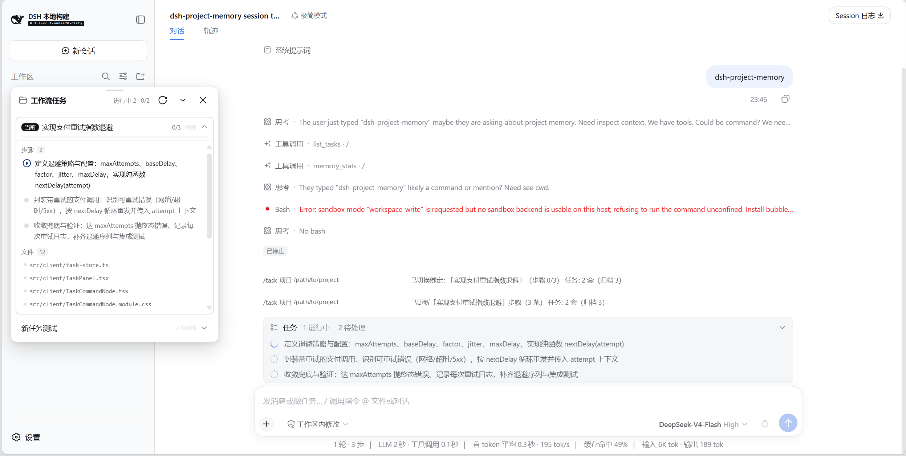

# dsh-project-memory

> 如果这个插件帮你省下 1 小时 Debug 时间，请点个 Star。

[English](README.md) | [简体中文](README.zh-CN.md)

[](https://github.com/00080000/dsh-project-memory/actions/workflows/ci.yml) [](LICENSE) [](https://www.npmjs.com/package/@yolk_vat-y/dsh-project-memory) [](https://www.npmjs.com/package/@yolk_vat-y/dsh-project-memory) [](https://dsh-plugin.org/plugins/00080000/dsh-project-memory) [](https://awesome-dsh-plugin.com)

为 [DeepSeek Harness](https://github.com/deepseek-ai/deepseek-harness)（dsh）agent 提供持久化的 **项目开发记忆**。专门针对项目开发，原生融合 dsh 任务系统，会话内任务清单与读过的文件自动沉淀为跨会话任务记录，任务↔文件自动关联——开发工作流可切换、可续接，无需重复梳理整个项目，解决上下文失效；文档（PDF/Markdown/txt）与代码符号写入工作区独立存储，文档自动交叉链接至所提及的代码符号；经验笔记（问题 → 方案）自动去重，避免重复踩坑。所有数据按项目落盘，跨会话压缩与交接保留，召回附带 `路径:行号` 可回源核实。无原生构建、无向量数据库。79 MB 的本地嵌入表 `leanvec` 随安装默认启用；它不在时自动退回纯词法。


> 插件在磁盘上维护一份精简的项目**记忆**，每条记录指向具体的文件与行号；agent 需要快速了解项目时先查**记忆**，无需重读整个项目。


## 特性

- **TaskBridge：跨会话开发任务** — 会话内的任务清单与触碰过的文件持久化为项目任务实体，工作流可以随时切走再续接，不必重新界定项目范围。关联文件按最近活跃排序（读取永远不越过写过的文件），续接时一眼看到该先看哪些。新会话通过 `list_tasks` → `select_task` 续接。委派给子代理的工作不会建档。旧宿主下降级为纯记录。
- **任务面板与编辑** — 卡片可拖拽，展示任务步骤与涉及文件，可折叠为迷你条或彻底隐藏；标题、步骤与状态支持行内编辑，与模型更新走同一条写回路径；四档外观风格只改材质、几何、字型与密度，颜色跟随宿主。面板默认隐藏，仅在显式唤起后出现；会话切换只后台同步，刷新页面不会自行打开；渲染错误有边界兜底，面板崩溃不会拖垮宿主。
- **文档记忆** — PDF、Markdown 与纯文本按块切分并生成摘要，索引期不调用模型。每条保留一段简短摘要供注入、一个有界的检索词集合，以及回源引用。
- **代码符号记忆** — 零依赖扫描器提取函数、类、方法、接口与类型别名及其完整签名，覆盖 8 种语言。项目装了 `typescript` 时，可选第二层补推导返回类型、泛型与接口，后台执行、不阻塞索引。
- **读到即记忆、变更即刷新** — 文件在模型实际读取的瞬间被记忆，记忆是正常工作的副产品，而不是额外的一次全量扫描；从未读过的文件不会被记忆。后台轮询只重记变更过的文件。
- **文档 ↔ 代码交叉链接** — 文档提及的符号，在查询该符号时一并带出。链接按**当前**符号表解算，不会过期。
- **混合召回** — 对文档、符号、经验笔记与 insight 排序召回，可选 LLM 查询扩展。`leanvec` 是 optionalDependency：默认装上并按余弦重排经验/洞察两层，没装或 `vectorDir: 'off'` 则退回纯词法。针对 CJK 增强：短语加分、同义词表，以及文档↔符号链接的词边界处理。
- **经验笔记** — 记录问题 → 方案；相似问题覆盖而不重复，数量随项目规模有界，与教训走同一条注入通道：检索与自动注入都能带出。
- **分层 insight 记忆（教训 / 决策 / 流程）** — 同一实体贯穿任务、项目、全局三级。近重复合并或强化；提升是更换归属而非复制。被使用会记账，因此衰减与容量按活跃度排序，而不是只按时间。面板提供分级的记忆视图用于审核与编辑；列表按新→旧排列并增量加载——每页 30 条，滚到底前就预取下一页，离屏行不参与渲染，记忆变多也不卡。
- **触发式注入** — insight 可携带 authored trigger：只有 `when` 能触发，`guard` 只能收窄，`prevents` 记下没有它会坏在哪。语料正文永远不能触发注入；统计通道另有独立门槛，默认沉默。**证据来源分级**：只有宿主事实（结构化工具调用、`fs`/`todo` 事件）与真人消息里的不可逆外部动作（提交 / 发布 / 发版 / 推送 / 部署 / 公开）能触发全文注入；散文里的"删除 / 清理 / 渲染 / 基准"只进提示通道，子代理提示词与通知类消息不参与动作判定——它们曾让一个真实会话 72% 的注入字符是噪音。
- **用法也是一个 skill** — 向宿主 `skills` 注册 `project-memory`（目录 bundle，含 `scripts/pm-digest.mjs`，`resourceBase` 指向包内目录）。模型按需加载查询 / 写入流程，不占常驻提示；没有 `skills` 服务的宿主静默跳过。

## 安装

插件只依赖通过 peerDependencies 声明的稳定公共 API。

```bash
cd dsh-project-memory && dsh plugin --profile web add . -w
```

`-w`（workspace-root）标志是必需的：profile 目录是 pnpm 工作区根目录，不带该标志 pnpm 会拒绝 add。其他目录下用同样的命令加上绝对路径即可。

插件同时发布在 npm 上（scoped 包）：

```bash
dsh plugin --profile web add @yolk_vat-y/dsh-project-memory -w
```

每个被索引的项目在 `<root>/.dsh-project-memory/` 下有独立存储；它默认就把自己排除在 git 之外，`.gitignore` 无需任何添加。

## 用法

以下工具由 **agent 自动调用**，无需用户手动输入。在对话中直接说自然语言即可——例如「给这个项目建个索引」或「auth 模块是干嘛的」，或者正常开发即可——agent 会自动调用对应工具。默认开启「读到即索引」：模型读哪个文件，就顺便索引哪个文件，记忆在你干活的过程中自然积累。`watch_repo` 让显式监听的根目录在后台保持新鲜；`index_repo` 强制对项目做一次全量回填（未变更文件自动跳过）。

在 git 工作树里，语料就是 `git ls-files --cached --others --exclude-standard` 的清单——已跟踪文件，加上未被忽略的未跟踪文件——因此 `.gitignore`（含嵌套规则）决定什么会被记忆。不是 git 工作树的目录退回普通遍历（不套忽略规则）。「读到即索引」对单个文件套用同一判据；显式 `index_doc` 则总是索引你指定的文件。

| 工具 | 用途 |
|---|---|
| `index_doc file_path` | 索引单个文档（PDF/MD/txt）：分块、确定性摘要，带 `路径:行号` 入库。未变更文件自动跳过。 |
| `index_repo root` | 索引整个项目：文档生成确定性摘要，代码文件生成零 token 符号表。增量更新，store 跟随文件清单：已删除、被忽略或移走的文件会被清理；文档与符号交叉链接。根目录不存在或在排除名单上时，会在写入任何内容前拒绝。 |
| `watch_repo root` | 启用自动刷新：后台轮询检测新增/变更文件，仅重抽这些文件。监听的项目在插件重启后自动恢复；不存在或在排除名单上的根目录会被拒绝，已消失的根目录会被丢弃而不是被重新创建。 |
| `memory_stats root` | 查看记忆库内容：总量、最近索引时间，以及按时间排序的逐文件清单。 |
| `query_memory query` | 对文档、符号、经验与 insight 执行排序检索，可选 LLM 查询扩展。`type` 选择层（`all` / `doc` / `symbol` / `experience` / `insight` / `task`）。返回带相对分数、引用或 insight id、以及文档→符号链接的结果。 |
| `list_tasks` | 列出本项目任务记录（含归档，带标记）。新会话/续接前先调用。 |
| `select_task` | 将会话绑定到某任务（此后 todo 清单与读文件同步进该任务）。按 `taskId` 精确绑定，或按 `title` 完全匹配（多个同名返回候选；无则新建）。带 title 可改名；自动解归档。 |
| `archive_task` | 归档任务（隐藏默认视图、不占容量、停止同步）。`select_task` 可恢复。 |
| `show_task_panel` | 在 UI 中打开任务面板。用户要求查看任务列表或你想展示面板时调用。 |
| `/tasks`（用户输入，不经模型） | 唯一的用户命令：展示任务栈并驱动工作流卡片。其余动作是它的**子动词**，由卡片按钮调用：`switch` / `archive` / `unbind` / `rename` / `todos …` / `step` / `step-move` / `step-text` 为任务动作，`insight list [scope] [offset] [limit]` / `confirm` / `promote` / `demote` / `archive` / `restore` / `delete` / `save` / `edit` 为记忆动作。 |
| `remember problem solution` | 保存经验笔记。它就是 `kind: 'experience'` 的 insight——与教训 / 决策 / 流程同库、同去重、同删除入口。相似问题合并或覆盖而非重复。 |
| `forget id_or_query` | 删除记忆——教训 / 决策 / 流程与经验笔记一视同仁，task / project / global 全层一次搞定，不必先知道它在哪一层。精确 id 删那一条；关键词按**查询侧覆盖率**匹配（命中词 ÷ 查询词数）。真删、无撤销；关键词命中超过上限（默认 10）时**一条都不删**，只列出候选。最近删除的 **5 条**会以完整条目留在该层 store 同目录的 `deleted.json`（项目层 `<root>/.dsh-project-memory/deleted.json`，global 层在 global 文件旁），删除回报里给出真实路径——删错时读它、重新保存一次即可找回。 |
| `save_lesson` | 在 task/project/global 任一作用域保存教训 / 决策 / 流程；带 `id` 就是**就地覆盖**既有条目（只改本次显式传的字段，旧值留在 `prev`，用同一个 id 再写一次即可写回）。写入前与既有记忆比对：余弦 ≥ 0.9 自动覆盖那一条，≥ 0.7 在返回里提示近邻 id；`leanvec` 不在时退回词法 overlap ≥ 0.7 合并、0.65–0.7 强化。同一 insight 被 2+ 任务命中自动 task→project、3+ → global。主要参数：`id`、`title`、`kind`、`scope`、正文（`pattern`/`fix`、`choice`/`reason` 或 `steps`）、`trigger`（`when` 是唯一触发面，`guard` 只能收窄，`prevents` 记下没有它会坏在哪）。 |

`/tasks` 在 web 的 `/` 菜单里以带图标的**「工作流」**组呈现 —— 三个视图入口：任务 / 项目记忆 / 全局记忆（标题随界面语言切换）。它是插件唯一注册的命令，其余动作全部作为它的子动词由卡片按钮驱动。

## 工作原理

设计遵循四个原则：

- **易失性** — 上下文是临时的，会话压缩即丢失。
- **持久性** — **记忆**存于磁盘，跨压缩与会话保留。
- **紧凑性** — 代码层每个符号只存一行有界声明，文档层每个 chunk 保留 ≤300 字符的摘要与有界词项。**派生数据一律不落盘**：doc→symbol 链接在读取期计算。最终体积取决于符号密度与 chunk 长度，下面是特定语料的实测值（2026-10-13），不是承诺：纯代码的前端应用（289 文件）实测 **325 bytes/条目 ≈ 源码 21%**；符号密集的 TypeScript monorepo（12,634 文件 / 代码 107 MB + 文档 14 MB）实测代码层 **占源码 22%**（整库 549 bytes/条目）、文档层 **占其源码 127%**；文档占比高的语料单条目最大，一个文档为主的工作区（Markdown + PDF）实测 **1,401 bytes/条目**。
- **可核验性** — **召回**在适用时携带 `路径:行号` 引用，agent 可对照源文件核实。

构建**记忆**无需预先全量扫描：文件在模型读取时被记忆，**记忆**恰好覆盖实际处理过的内容。未变更的文件重读是空操作，因此持续维护开销很低。

存储按项目独立存放，并跟随代码库变化：文件变更按内容哈希重新抽取，文件删除则同步移除。经验笔记是 `insights.json` 里 `kind: 'experience'` 的条目，仅检索、累积不影响上下文。

## 设计

```
.dsh-project-memory/
  format.json      布局标记（v2，分片式）
  shards/          每个被索引源文件一个自描述 JSON —— 写入只落脏分片
  watch.json       被监听根目录
  tasks.json       TaskBridge 任务实体（跨会话）
  binding.json     当前会话 ↔ 任务绑定
  insights.json    项目级记忆（教训 / 决策 / 流程 / 经验笔记）——唯一实体
  vectors.json     可选语义索引（只在向量层启用时存在）
  injection-audit.jsonl   每次真实注入一行（注入了什么 / 为什么 / 丢了什么 / 额度）
  admission-shadow.jsonl  每步一行，全部被评分的候选 + 特征（离线重放）
```

- **增量** — 按文件内容哈希，仅重新抽取变更文件。
- **交叉链接** — `query_memory` 返回文档 chunk 时，按**当前**符号表解算它提到的符号，以 `references` 带出。文档先索引、符号后到也能链上。
- **查询扩展** — `llmQueryExpansion` 开启时，把查询改写为多个变体（同义词、中英、符号名猜测）再合并分数；关闭时查询完全不碰 LLM。索引本身不调用模型。
- **一致性** — 事实层跟随代码库（哈希重抽 / 删除即移除）；经验层仅检索，配合覆盖与 `forget` 机制。写入在跨进程的目录锁（`.write.lock`）内做一次短暂的读改写，因此两个 dsh 实例可以共用一个项目存储：分片按 `indexedAt` 收敛，拿不到锁的那次保存会延后重试。

## 架构（任务面板）

```
TaskPanel (Container)
├── task-data-store  (服务端数据，跨标签页 BroadcastChannel 同步)
├── task-ui-store    (本地 UI 状态，localStorage)
├── task-hooks       (useTaskDrag, useTaskEdit)
└── TaskComponents   (MiniBar, TaskCard — 纯展示组件)
```

工作流卡片可收起，自动适应 dsh 及主题插件风格，提供四种卡片风格切换。


## 配置

| 键 | 默认值 | 含义 |
|---|---|---|
| `memoryDir` | `.dsh-project-memory` | 每个被索引根目录内的存储目录 |
| `chunkChars` / `maxChunksPerFile` | 3000 / 40 | 每个文档块最大字符数、每文档最大块数 |
| `maxFileSizeMb` | 10 | 大于该值（MB）的文档（含 PDF）/代码文件跳过；峰值系数见下文「单文件内存预算」 |
| `maxPdfPages` | 1000 | PDF 页数上限 |
| `maxOutputChars` | 8000 | `query_memory` 返回文本上限（字符） |
| `lazyIndexing` | true | 模型读取文件的瞬间即索引 |
| `autoIndexOnFirstUse` | false | 插件加载时对当前工作目录做全量扫描（可选） |
| `watch` / `watchInterval` | true / 30 | 后台刷新；基础轮询间隔（秒）；回合进行中静默（5 分钟兜底，外部改动仍会自愈），回合结束立刻合并扫一次；空闲时逐步退避到最长 2 分钟，一有变化立即回到该值 |
| `maxScanFiles` / `maxScanDepth` | 20000 / 12 | 单次扫描的文件数与目录深度硬上限；被截断时会在报告里说明，且不会删除没扫到的条目。**无法取消**：`0` 或任何非法值都回落到默认值 |
| `allowUnsafeRoots` | false | 兼容开关：放开**内置**排除名单，所有根判定入口（含懒索引、会话审计、任务桥）都生效。它只作用于内置名单——`roots.deny` / `roots.exclude` 仍然优先；只想放开一个目录时用 `roots.allow` |
| `roots.allow` / `roots.deny` / `roots.exclude` | `[]` / `[]` / `[]` | 自定义根名单（机器/配置档级，CLI 与 web 通用）。`allow` / `deny` 精确匹配目录本身；`exclude` 按路径边界前缀匹配整棵子树（其中的文件一律不进索引）。优先级 `exclude` > `deny` > `allow` > 内置名单，文件系统根永远不能当根。支持 `~`/`~/...`；非绝对路径忽略并在 stderr 告警一次；Windows 下大小写不敏感 |
| `llmQueryExpansion` / `expansionCount` | false / 6 | 检索前用 LLM 扩展查询（默认关闭，节省 token）；扩展变体上限 |
| `tsPath` / `enableTypeScript` | (自动) / true | 可选：强制指定 `typescript` 安装路径；`enableTypeScript: false` 彻底禁用类型感知层 |
| `tasklist.enabled` / `tasklist.syncHostOnAdopt` | true / true | TaskBridge 自动同步（由会话 todo 清单与文件读取沉淀任务实体）；绑定任务时把其步骤推给宿主任务清单，使 dsh 镜像该任务 |
| `insight.*` | dedupOverlap `0.7` · reinforceBand `0.65` · autoMergeCos `0.9` · autoMergeMargin `0.05` · hintCos `0.7` · maxForgetMatches `10` · maxProject `100` · maxGlobalProcedures `200` · promoteConfidence `0.7` · globalPromoteTasks `3` · decayDays `90` · `globalFile`（自动） | insight 去重 / 自动覆盖 / 近邻提示 / 删除上限 / 强化 / 提升 / 容量 / 归档设置。`autoMergeCos` / `hintCos` 设 `0` 表示**关闭**那条带 |
| `reflection.enabled` | false | LLM 反思，**只写任务级草稿**（触发于任务切走 / 归档）。`cooldownMs` `1800000`、`maxLessonsPerReflect` `3`、`maxDecisionsPerReflect` `2` |
| `autoContext.enabled` | true | 静默注入包装（常驻任务卡 + 受门槛约束的条目）；宿主无法解析会话 cwd 时完全透传。`maxTokens` `400`（单轮）、`editedMax` `3`（任务卡显示的最近"编辑中"文件数）、`signalMinRatio` `0.5`（提示至少达到该层最高分的一半）、`skipEchoSelfTodo` `true`、`budgetLog` `off`、`reinjectItemsAfter` `0`（同一条 insight 重复注入的冷却步数）、`rootNotice` `true` |
| `autoContext.gateCooldownSteps` | 2 | **准入旋钮**：两次*条目*注入之间至少隔几步（常驻任务卡不受限——它是状态快照）。这是"别频繁注入"的主旋钮 |
| `autoContext.maxItemsPerSession` / `autoContext.maxItemCharsPerSession` | 60 / 24000 | **runaway 保险丝，不是节流阀** —— 按条数与字符计的每会话硬上限：一旦触顶，本会话余下部分条目通道持续沉默 |
| `autoContext.hintMinCoverage` | 0.45 | 提示通道的**绝对**下限：条目覆盖了查询多少 IDF 加权信息量。只用相对阈值分不出"有信号"和"矮子里拔将军" |
| `autoContext.hintMinMatched` / `autoContext.hintMinSupport` | 2 / 0.15 | 提示还必须至少共享这么多个词；且查询里能在语料中找到对应的词占比不低于该值时，通道才出声——否则本轮整体沉默 |
| `autoContext.vectorDir` | 未设 | **可选**语义层，只作用于经验/洞察两层；随 `leanvec`（optionalDependency）默认装上并启用（79 MB、约 +130 MB RSS）。填 `off` 强制纯词法；填路径或用 `DSH_LEANVEC_DIR` 可覆盖。只改排序、返回条数不变；启用时只有**没拿到余弦**的条目才继续按词法命中数筛 |
| `autoContext.vectorAlpha` | 0.5 | 这两层内 `(1-α)·词法分 + α·余弦` 的权重；`0` 只关闭重排（写入侧去重仍在），`1`（纯向量）实测更差 |
| `autoContext.vectorDedup` | true | 写入侧近重复检测（余弦 ≥0.9 自动覆盖、≥0.7 近邻提示）。与 `vectorAlpha` 独立；设 `false` 不影响召回排序 |
| `autoContext.vectorItemMin` / `autoContext.vectorSpeakMin` | 未设 | **实验性**：提示通道的绝对余弦地板（条目级）与通道级语义救援。未标定——不设即关闭，开启前先看 `src/auto-inject.js` 里的实测证据 |
| `autoContext.legacyScope` | `ignore` | 旧 `trigger.scope` 的处理：默认 `ignore`，不拿它当过滤条件；`filter` 拿它当过滤条件。`npm run selfcheck:triggers` 会列出仍带 scope 的条目 |
| `autoContext.auditLog` | true | 每次**真实**注入往 `injection-audit.jsonl` 追加一行（注入了什么、为什么命中、丢了什么、会话额度）；超过 `auditMaxBytes`（`262144`）轮转 `.1`。任何 IO 失败都静默 |
| `autoContext.shadowLog` / `autoContext.shadowMaxBytes` | true / 524288 | **每步**（含什么都没注入的步）往 `admission-shadow.jsonl` 追加一行：被评分候选及其特征，以及每条候选卡在哪一关 —— 它让"换个阈值会怎样"可以离线回答。只写盘、不进 prompt；超过上限轮转，只保留一代 `.1` |

### 功能开关

两个最常用的开关是 `lazyIndexing`（模型读取文件的瞬间即索引；默认开启）和 `autoIndexOnFirstUse`（插件加载时对当前工作目录做全量扫描；默认关闭）。懒加载建立的索引根会自动注册到 watcher，文件变更无需手动 `watch_repo` 也能保持新鲜。

**项目根怎么定。** 按顺序：显式 `root` 参数 → 登记的根（`watch_repo`）→ 最近的 VCS 标记（`.git`/`.hg`/`.svn`）或构建/清单标记（`package.json`、`go.mod`、`Cargo.toml`、`pyproject.toml` 等）所在祖先 → 会话工作目录（前提是它不在排除名单里）。都不命中则不索引该文件。

根来自工作目录时，模型每个会话收到一条通告，说明根的位置与改法；`autoContext.rootNotice: false` 关闭。因此在 `~/workspace` 这类容器目录里启动 dsh，该目录就是根，记忆覆盖其下所有项目直到扫描上限——想一个项目一个 store，就在项目目录里启动。

**排除名单。** 以下目录不会作为根，精确匹配（子目录不受影响）：文件系统根、家目录、临时目录（`os.tmpdir()` 与共享的 `/tmp`、`/var/tmp`、`%TEMP%`、`%SystemRoot%\Temp`），以及系统/包管理器前缀（POSIX 上的 `/opt/homebrew`，Windows 上的 `%SystemRoot%`、`%ProgramFiles%`、`%ProgramData%`）。这些目录下的会话默认不启用记忆，stderr 输出一行说明。

**自定义根名单。** 在同一份配置的 `roots` 下可以覆盖上述判定；三项都支持 `~`/`~/...`，非绝对路径会被忽略并在 stderr 告警一次（相对路径按宿主 cwd 解释，不可预测），Windows 下大小写不敏感：

- `roots.allow`：即使命中了内置名单也允许作根，精确匹配；文件系统根不在此列。
- `roots.deny`：这个目录不能当根，精确匹配；它的子目录仍可各自成根。
- `roots.exclude`：这棵子树里的文件一律不进索引，按路径边界前缀匹配（含子目录）；也不能在这里推出新的根。父根的完整扫描会跳过它，之前索引过的条目会在下一次完整扫描时清理。

注意 `deny` 只决定这个目录自己能不能当根：父目录已经是根时，`deny` 的子目录仍会被父根索引——要连文件一起排除请用 `exclude`（或 `.gitignore`，git 仓库里的扫描本来就尊重它）。显式 `index_doc` 也服从 `exclude`，被排除的文件会返回 `Not indexed`。

优先级是 `exclude` > `deny` > `allow` > 内置名单。`allowUnsafeRoots: true` 保留为兼容，只放开内置名单，`deny` / `exclude` 仍然优先。生效面是同一套判定：显式工具调用、懒索引、watch、会话审计、任务桥。新增 `deny` / `exclude` 后，已登记在 `watch.json` 里的根会在下次启动自动摘掉。配置写在 `- id: project-memory` 的 `config:` 下（CLI 与 web 都适用）；Web 端暂未提供正式配置页。

**扫描上限。** 单次扫描最多 `maxScanFiles` 个文件（20000）、`maxScanDepth` 层目录（12）。被截断时，`index_repo` 的结果里会说明，watcher 每个根记一行，且不会删除没扫到的条目。**读不到的目录**（如 `EACCES`）同样算一次截断扫描并在结果里点名：读失败不等于被删除。

**单文件内存预算。** `maxFileSizeMb` 管的是内存而不是磁盘偏好。索引一个文件要先把它整个物化——代码是整个 buffer 加解码后的正文，文档是逐页正文再加拼出来的 markdown——峰值随文件大小线性走。用 `npm run bench:peak` 实测（1–50 MB 阶梯，每档一个独立进程，对「峰值 RSS = a + b × 磁盘 MB」做最小二乘）：典型源码（约 1 个声明 / 1.4 KB）**≈10×**，符号密集的代码（1 个 / 220 B）**≈22×**，文本型 PDF **≈20×**；此外还有约 52 MB 的进程基线，以及首次解析 PDF 一次性约 175 MB 的底座。默认 10 MB 因此把单个文件的增量压在 **+300 MB RSS**（代码）/ **+370 MB**（PDF）量级；调大它就按比例抬高这个上限。

store 建在被索引的目录树里，并且**自我忽略**：自己目录内的一条 `*` 规则让它不出现在 `git status` / `git add -A` 里，`git clean -fd` 也不会删它。确实想把记忆跟着仓库提交：`git add -f .dsh-project-memory`——已跟踪文件不受忽略规则影响。

配置存放在插件的 config 对象中。修改方式：在 profile 的 `cordis.patch.yml` 里加一条覆盖项——web profile 对应 `~/.dsh/profiles/web/cordis.patch.yml`：

```yaml
- id: project-memory
  config:
    lazyIndexing: true          # 开启：模型读到哪个文件就索引哪个（默认）
    autoIndexOnFirstUse: false  # 关闭：不做加载时的全量扫描（默认）
    llmQueryExpansion: false    # 关闭：不用 LLM 扩展查询，节省 token（默认）
    watch: true                 # 开启：被监听根目录后台保持新鲜（默认）
    watchInterval: 30           # 基础轮询间隔；回合进行中静默、回合结束补扫，空闲退避到最长 2 分钟
    maxScanFiles: 20000         # 单次扫描文件上限（截断会报告，且不会误删旧条目）
    maxScanDepth: 12            # 单次扫描目录深度上限
    enableTypeScript: true      # 开启：装了 TS 时启用类型感知增强（默认）
    # allowUnsafeRoots: false   # 兼容开关：只放开内置名单；优先改用下面的 roots.allow
    # roots:                     # 自定义根名单（默认全空）
    #   allow: [/srv/projects/demo]        # 精确放行内置名单里的目录（文件系统根不可放行）
    #   deny: [/srv/shared]                # 精确拒绝这个目录本身；子目录仍可成根
    #   exclude: [/srv/monorepo/archive]   # 子树前缀：里面的文件一律不进索引
    # tsPath: /custom/path/to/typescript  # 可选：强制指定 TS 安装路径
    # autoContext:              # 注意：下面两个键在 autoContext 下，不是顶层
    #   budgetLog: once         # 调试用：注入被预算挤掉时在 stderr 留痕（默认 off 静默）
    #   reinjectItemsAfter: 20  # 调试用：同一条 insight 隔 N 步才允许重发（默认 0 = 本会话只发一次）
```

只需列出要改的键，其余键回落到插件默认值。用 `dsh --profile web --dump-config` 验证生效。

不想改 profile 文件、只想临时试一次，可用 CLI 补丁覆盖：

```bash
dsh web --patch ./config.yml
```

其中 `config.yml` 内容就是上面的覆盖块。

## 性能

### 真实项目实测（2026-10-13）

四个语料、同一台 Linux 机器（Node 24.19），每个跑两遍、引用**第二次（页缓存已热）**的数据。「冷索引」= 完整索引一轮（walk + 哈希 + 抽取 + 落盘）；「查询」= 线上同一套 scorer 跑 100 条采样；「单文件重索引」= watch / 懒索引热路径。

| 语料 | 文件数 / 条目数 | 冷索引 | 冷加载 | 查询 p50 / p95 | 单文件重索引 | 存储内容 / 落盘 | 加载后堆 |
|------|----------------|--------|--------|----------------|--------------|----------------|----------|
| 前端应用（纯代码） | 289 / 2,142 | 246 ms | 8 ms | 0.76 / 1.4 ms | 0.3 ms | 0.66 MB / 1.52 MB | 6.3 MB |
| 文档工作区（Markdown + PDF） | 249 / 977 | 705 ms | 10 ms | 1.8 / 5.5 ms | 0.4 ms | 1.31 MB / 1.84 MB | 6.8 MB |
| TypeScript monorepo，3,000 文件切片 | 3,000 / 17,576 | 1.9 s | 70 ms | 9.2 / 18.9 ms | 1.9 ms | 10.9 MB / 18.9 MB | 22.7 MB |
| TypeScript monorepo，整棵树 | 12,634 / 80,231 | 7.8 s | 278 ms | 40.6 / 74.8 ms | 7.2 ms | 42.0 MB / 75.7 MB | 75.2 MB |

**扩展形状。** 重索引一个变更文件的成本是 O(文件)、不是 O(语料)——上面每个语料都在 0.3–7.2 ms。冷加载（≈22 µs/文件）、查询（最大语料 ≈0.5 µs/条目）与常驻堆（查询一次后 ≈1.5 KB/条目）随索引规模线性增长，因此小型与中型项目都落在个位数毫秒。

> `read+hash` 受操作系统页缓存影响——12,634 文件时冷缓存 2.3 s、热缓存 0.27 s——上表引用的是热缓存那一遍。

### 合成基准测试（Node 24.19，Linux）

| 场景 | 规模 | 实测 |
|------|------|------|
| 批量冷记忆构建 | 5,000 文件 / 20k 条目 | 284 ms 均值（p50 286）|
| 冷加载 | 5,000 文件 | 58 ms |
| 热路径懒记忆 | 单文件重记忆+落盘 | p50 2.5 ms / 最大 6.7 ms (5k) |
| query_memory (缓存命中) | 5k 文件 / 20k 条目 | p50 2.9 ms / p95 6.0 ms |
| query_memory (缓存命中) | 1k 文件 / 4k 条目 | p50 0.5 ms / p95 1.1 ms |
| 批量冷记忆构建 | 10,000 文件 / 40k 条目 | 558 ms 均值（p50 540）|
| 冷加载 | 10,000 文件 | 117 ms |
| 热路径懒记忆 | 单文件重记忆+落盘 | p50 5.5 ms / 最大 8.4 ms (10k) |

> 合成基准：生成代码（~4–5 符号/文件），实测于 2026-10-13。复现命令 `npm run bench:synthetic -- 5000`（脚本 `scripts/bench-synthetic.mjs`）。测量纯索引开销，不含 LLM 调用。写入后的首次查询会重建 IDF 缓存（**40k 条目 141 ms**，20k 条目 68 ms，4k 条目 17 ms），后续查询命中缓存。

### 自己复现这些数字

测量本身随仓库发布，**也随 npm 包一起发布**（`scripts/` 已包含在 tarball 中）。脚本**不需要 dsh 实例、不需要网络、不调用任何模型**，也**不碰被测项目自己的 store**——结果写进临时目录，跑完删除：

```bash
npm run bench -- /你的/项目路径
# 或带参数：
node scripts/bench.mjs /你的/项目路径 [--json] [--samples 100] [--no-pdf] [--keep]
```

输出包含：冷索引（拆成 read+hash / extract / commit 三段）、冷加载、IDF 重建、冷查询与热查询延迟（100 条采样报 p50/p95/max）、单文件热重索引、存储体积、常驻堆与单条目字节数。示例——上表里的前端应用：

```
冷索引     246 ms   （read+hash 8 ms · extract 222 ms · commit 14 ms）← 第二次、页缓存已热
存储       内容 0.66 MB · 落盘 1.52 MB · 325 bytes/条目 · 冷加载 8 ms
内存       加载后堆 6.3 MB → 首次查询后 6.9 MB（RSS 62 MB）
热查询     p50 0.76 ms · p95 1.4 ms          （2,142 条目）
单文件重索引  p50 0.3 ms
```

带 `--queries 你的查询集.json` 可以在你自己的项目上跑标注集方法（hit@5 / hit@10 / MRR）。

## 设计取舍

- **短时文件锁，而不是嵌入式数据库** — 每次保存只在读改写期间持有排他的 `.write.lock`（解析在锁外完成），最多等 2 秒；对方忙时这次保存保持脏状态并在后台重试（打到 ~20s），**默认不打扰用户**——记忆写入幂等、失败成本低，需要排查时设 `DSH_PROJECT_MEMORY_DEBUG=1` 才会打印一行。锁内容带 `pid` / `host` / `token`：同机持有者活着就绝不抢，release 校验所有权、不删别人的锁；崩溃残留的同机死锁按 pid 立即回收。两个 dsh 实例因此可以共用一个存储。没有 WAL、没有常驻进程、没有原生依赖。
- **Watch：事务外计算，事务内提交** — 不持锁解析，也不用 `fs.watch`：轮询 + mtime/内容哈希在网络盘、Docker 卷、WSL 上行为一致，没有 `fs.watch` 的重复触发/漏事件问题。
- **损坏分片隔离，不自动修复** — 解析失败的分片改名、只重索引该文件；不引入 WAL 或嵌入式数据库，那会带来原生依赖、锁竞争与它们自己的新故障模式。
- **向量只重排，不做排序主力** — 在**改写成不含原词**的查询集上，纯向量替换差于 BM25（hit@10 **53% vs 69%**），加权融合只在**小 k** 上更好（hit@3 **53% vs 50%**），所以可选层只重排经验/洞察两层、绝不参与闸门。词法检索在本插件针对的查询上依然够用：真实项目 29 条标注查询的文件级 hit@5 为 **96.6%**，整 chunk 词项把文档词项覆盖从 **27.3% 提到 100%** 且 MRR 不变（**0.958** vs **0.955**）。
- **索引确定且不调用模型** — 索引期不调模型、查询期也不翻译：前者会让同一份文档两次索引结果不同，后者有一个硬失败模式（译错 = 零召回）；规则 + 符号链接已经覆盖常见情况，且离线可用。
- **面向模型的记忆：agent 自己写，不把人放进回路** — 记忆的消费方是 agent，而 agent 通常是无头的，只在有人点卡片时才升级的记忆等于永远不会升级。`draft` 是「来源标记 + 佐证门槛」而不是审批队列。
- **直接返回完整条目** — 条目本就紧凑，完整返回更可核验，也少一轮往返。
- **`forget` 按关键词激进；精确请用 ID** — 经验笔记低风险、高量、仅用于检索，陈旧噪音比误删更伤。精确删用 `query_memory` 输出里的 ID。
- **TS 增强可选、异步、缓存** — 后台执行、不阻塞索引，没有 TS 时回退正则扫描；队列有上界，被丢弃的文件会在报告里给出条数。**默认 lib 不加载**：依赖全局类型（`Promise`/`Array`/DOM）的推导会退化成 `any`/`unknown`，显式标注的类型不受影响。
- **子代理会话暂不纳入（以后可能做）**

## 开发（面向贡献者）

以下命令用于**维护插件源码**，普通用户无需执行。安装插件只需使用[安装](#安装)一节中的命令。

```bash
npm install
npm test                    # 833 项测试
npm run eval:injection      # 合成池 P/R：精确率 0.93 / 召回率 1.00，另有 3 个 hint-only 场景
npm run eval:injection -- --store .dsh-project-memory/insights.json   # 用你自己的 store 重放；对照组是硬闸门
npm run selfcheck:triggers  # 哪些条目还推得动、哪些声明是死的（读你本地的 store）
npm run bench -- /你的/项目路径   # 对任意项目量索引/查询性能，不需要 dsh
npm run bench:peak          # maxFileSizeMb 的峰值 RSS 预算，1–50 MB 阶梯实测
npm run schema:size         # 每个工具的固定 prompt 开销：字符数 + 同口径 token 粗估
```

发布说明见 [`CHANGELOG.md`](CHANGELOG.md) 与 [GitHub Releases](https://github.com/00080000/dsh-project-memory/releases)。

## 许可证

MIT，全文见 [`LICENSE`](LICENSE)。

Copyright (c) 2026 00080000 &lt;3388065969@qq.com&gt;
